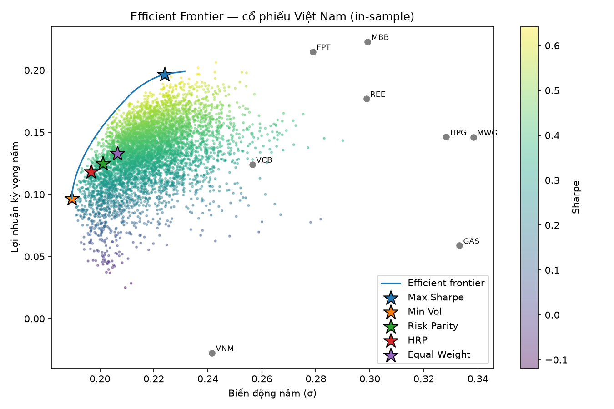

# Tối ưu hóa danh mục cổ phiếu Việt Nam (Modern Portfolio Theory)

So sánh 5 chiến lược phân bổ: Max Sharpe, Min Volatility, Risk Parity, HRP, Equal Weight
trên 8 cổ phiếu VN (2019–2026), backtest walk-forward có phí giao dịch, so với VN-Index.

## Kết quả chính
- Max Sharpe tối ưu nhất trên lý thuyết nhưng tệ nhất khi backtest out-of-sample (sụt giảm −41%)
- Equal Weight có Sharpe cao nhất; HRP và Risk Parity giảm sụt giảm tối đa xuống ~−26%

## Cài đặt
    py -3.12 -m venv .venv
    .venv\Scripts\activate
    pip install -r requirements.txt
    pip install -U --extra-index-url https://vnstocks.com/api/packages vnstock
    python mpt_vn.py

## Công nghệ
Python, PyPortfolioOpt, pandas, SciPy, Plotly, vnstock
